# Frontend release review — fineprint v1.2.0 (2026-10-21)

| | |
|---|---|
| Explorer (deployed and verified) | <https://s2002kumar.github.io/fineprint/> |
| Repository | <https://github.com/s2002kumar/fineprint> |
| Release identifier | tag **`v1.2.0`** on the commit that adds this file |
| Frontend change | [PR #1](https://github.com/s2002kumar/fineprint/pull/1): branch `frontend-v1.2`, commit `67061eb`, merged into `main` as `590e97e` |
| Approved design | Lovable project `926fa28f…`, synced to the private repository `s2002kumar/fineprint-editorial-design-final`. The app source is the approved commit `f8fb3e4` ("Added prov link to disclosure", 2026-10-20 22:22 UTC). The synced head `15adc42` changes only `README.md`. |
| Earlier tags, unchanged | `v1.1.0` → `7ca0594`, `v1.0.0` → `24d22ba`, `dst04b-freeze` → `8ddfa24` |

This is a frontend-only release. The data exports (`site/data/`), the export script, the browser CSV module
(`site/explorer-core.js`), `src/`, graph rules, ingestion, refresh, migrations and every file under `evidence/historical/`
are unchanged. Everything listed as verified was checked by commands run on 2026-10-21.

## 1. What changed
### Design carried over from the approved prototype
- **Tokens.** These are the design's oklch values converted to sRGB:
  - chalk `#F7F6F1`, ink `#16221E` and pine `#274B3C`;
  - pine-soft for the current-snapshot strip;
  - amber `#B37736` and amber-soft for the 2023 replay only;
  - hairlines `#D8D8D1`;
  - 2–4 px radii.
- **Type.**
  - Newsreader, with optical sizes, for headlines.
  - DM Sans for the interface.
  - JetBrains Mono for identifiers and eyebrow labels.
  - The design's scale: a 68 px display headline, 12 px tracked mono eyebrows, 1,152 px measure, and 20/32 px gutters.
- **Home.**
  - Headline "Trace a medicine to the factory behind it.", with the dominant search field, a "Trace →" button and "Try" prompts.
  - Guided examples for Rocky Mount and McPherson.
  - "How a link is documented" evidence-path figure.
  - Corpus stats (55,064 label documents; 4,314 establishments).
  - Amber link to the 2023 case.
- **Facility.**
  - Current-snapshot strip, separate from the 2023 case.
  - "City, ST — Firm" heading, with a DUNS / FEI / status / sources row.
  - Counts summary with status dots.
  - Segmented All / Direct / Tentative / Unknown filter, CSV export, table, phone cards and status legend.
  - Right-hand evidence drawer.
- **2023 case.**
  - Amber "Historical · data as of 2023-07-18" strip.
  - Headline "46.1% shorter", with the 480 / −46.1% / 63/65 figures.
  - Fig. 1, proportional shortlist bars (0–890).
  - Fig. 2, the 65-cell recall strips.
  - Supplementary baselines, the event sequence, "What the result does not show", "How it was tested", and a link to the case study.

### Sample fixtures replaced by real data
| Design study | Production v1.2.0 |
|---|---|
| Two bundled sites: 5 sample rows for Rocky Mount, none for McPherson | All 4,314 establishment DUNS, from `site/data/current/facilities.json` |
| `illustrative-set-*` IDs, "Placeholder" versions, no hashes | The real set ID, version, version-selection class, document ID, publication and effective dates, XML location, release part → archive member → XML member, XML SHA-256, and DailyMed / FDA links |
| A single confidence label | DIRECT / TENTATIVE / UNKNOWN exactly as exported, with each reason code in plain language |
| "Export sample CSV" (7 columns, marked as a sample) | The existing 30-column CSV from `explorer-core.js`, unchanged, for the rows shown |
| Hard-coded headline numbers | Computed from `historical/rocky_mount_2023.json`: 480 vs 890, 46.1%, 63/65 for both, 886 and 62/65 for injectables |

A new test (`test_no_design_study_fixtures_in_site`) fails if any design-study fixture text reaches `site/`.

### Deliberate departures from the prototype
1. **Rows are called assertions, not packages.** Each row is one graph edge: an operation, a product and a label set.
   - The heading is "Manufacturing assertions", or "Operation assertions" for the two examples, which list every operation.
   - Package NDCs are in the drawer and in the CSV.
2. **Search.** The prototype jumped to one of its two fixtures. Production:
   - searches all 4,314 establishments;
   - requires every typed word to match, so the design's own placeholder "Rocky Mount, NC" finds Hospira first;
   - opens the facility directly only when exactly one establishment matches;
   - otherwise lists up to 50 matches. For example, "Rocky Mount" also matches 7 other establishments, mostly "Rocky Mountain" firms, and the list says so.
3. **Production content kept, though absent from the design:**
   - the identity record (status meaning, registration file and line, expiry, other DUNS with the same FEI, label names, labeler role);
   - the operation selector for the two examples;
   - "Missing or unresolved evidence";
   - the full frozen-cohort table with its own CSV;
   - cohort M, injectables-only and B3 rows in the supplementary table;
   - the About the data page, reached through a fourth nav item, "Data".
4. **Copy corrected to match the published evaluation:**
   - **Cutoff:** "label versions published on or before 2023-07-18", not "frozen as archived".
   - **Testing:** "pre-registered, then frozen; not blind; no blinding is claimed". The design's "not the same as an independent preregistered test" understated the pre-registration.
   - **Archive gaps:** the specific causes (no all-labels-on-a-date export; one set's pre-cutoff version unrecoverable).
   - **Caveats added:** "labels under-report sites" (149 of 890) and "the identity record predates 2023".
5. **Accessibility.**
   - The design's amber reaches only 3.5:1 as text (3.1:1 on amber-soft), so amber text uses `#7F4D20`, which is 6.5:1. Amber stays for rules, dots and fills.
   - Form controls use a 3.4:1 border.
   - The skip link no longer navigates to the home route; it was a pre-existing bug.
6. **Fonts are self-hosted** (SIL OFL 1.1, in `site/fonts/`). The prototype loaded Google Fonts; production makes no third-party requests.
7. **Phones show 60 cards, then "Show all".** Desktop tables show 500 rows. The CSV always holds every matching row.
8. **Facility headings outside the US use the registered firm name**, and the country goes in the eyebrow. FDA address fields outside the US are too irregular to extract a city reliably.
9. **Light theme only, as the design defines.** v1.1.0 followed the system dark mode; v1.2.0 does not.
10. **Fixed defects in the prototype:**
    - 24 px horizontal overflow on the case page at 320 px;
    - an XPath overflowing the drawer at 390 px;
    - the three headline figures colliding at 320 px.

### Files
- **Rewritten:** `site/index.html`, `site/style.css`, `site/app.js`.
- **Added:** `site/fonts/`, with 7 WOFF2 files and 3 license texts. They are verified against jsDelivr's published SHA-256 and kept byte-exact by `.gitattributes`.
- **Verification tools:**
  - `scripts/check_live_explorer.mjs`, rewritten;
  - new: `scripts/screenshot_explorer.mjs`, `scripts/verify_live_site.py` and `scripts/check_source_links.py`.
- **Tests:** three new site tests in `tests/test_site_data.py`.
- **Docs:**
  - `NOTICE.md`: font licenses;
  - `docs/CASE_STUDY.md`: caption;
  - `docs/img/`: two screenshots, plus the comparison set under `v1.2.0/`.
- **Version:** `pyproject.toml` is 1.2.0.

## 2. Verification
| Check | Result | Evidence or command |
|---|---|---|
| Test suite (local, PostgreSQL 18) | **87/87 pass, 0 skipped** (84 from v1.1.0 + 3 new site tests) | `python -I -m unittest discover -s tests -t . -v` |
| CI on the branch, the PR and `main` (`590e97e`) | `ci` passed (runs 39620769398, 39620823408, 39621031096). The PostgreSQL job ran 87 tests with **0 skipped**. The two stdlib-only jobs ran 87 with the expected 20 database tests skipped | GitHub Actions logs |
| Pages deployment | `pages` passed on `590e97e` (run 39621030992). It verifies checksums and dataset separation before deploying | GitHub Actions |
| Deployed files | **116/116** tracked `site/` files served byte-identical to the repository | `evidence/explorer/live_files_check.json` (`scripts/verify_live_site.py`) |
| Deployed site in a browser | **12/12 check groups pass** on the live URL (details below) | `evidence/explorer/live_browser_check.json` (`scripts/check_live_explorer.mjs`) |
| CSV buttons | Live Rocky Mount CSVs equal the reference rows of the site's CSV module: all 183 MANUFACTURE rows, the 3 UNKNOWN rows, all 728 rows across operations, and the 183 rows at 390 px. The historical CSV equals all 898 rows | `live_browser_check.json` |
| CSV module against the database | 34,494 current rows match SQL on all 28 fields, with 0 missing. Historical: 892 packages, 480 flagged, 65 on the list, 0 disagreements with the frozen cohort | `scripts/verify_explorer_csv.py --db fineprint` |
| Export determinism | 101/101 data files byte-identical to a fresh export | `scripts/export_explorer.py --db fineprint --verify` |
| Source citations | For 3 sampled rows (Rocky Mount DIRECT and UNKNOWN, McPherson DIRECT): the DailyMed label page returns 200, the version ZIP is a ZIP, the version is listed in its history, and FDA's SPL XML by document ID matches the displayed SHA-256 | `evidence/explorer/source_links_check.json` (`scripts/check_source_links.py`) |
| Historical evaluation unchanged | `evaluation_results.json` SHA-256 `749b4bb3…` unchanged. No frozen file differs from `dst04b-freeze`. Re-scoring through the seal-verifying script reproduces every cohort and metric; only `seal.tag_commit` differs (v1.1.0 known issue 2) | `scripts/hist_dst04b_unseal_and_score.py --out <tmp>` |
| Contrast (WCAG 2.2) | Ink on chalk 15.1:1. Muted text 5.0–5.7:1 on every background. Pine 9.0:1. Amber text 6.5:1 (5.9:1 on amber-soft). Button text 9.0:1. Control borders 3.4:1 | computed from the tokens in `site/style.css` |
| Responsive layout | No horizontal overflow on any page at 1440, 768, 390 or 320 px | final captures; live check at 390 and 320 px |
| Reduced motion | Drawer animation 0.00001 s with `prefers-reduced-motion: reduce`, 0.2 s otherwise | `live_browser_check.json` |
| Keyboard | Tab order and outcomes: <ul><li>The first Tab reaches the skip link, which moves focus to the page heading without changing the route.</li><li>Enter on "Evidence →" opens the drawer with focus on "Close · Esc", and the background is `inert`.</li><li>Tab and Shift+Tab stay inside the drawer.</li><li>Escape closes it and returns focus to the button that opened it.</li><li>Clicking the overlay also closes it.</li></ul> | `live_browser_check.json` |
| Third-party requests and errors | 193 requests during the live check, **0** to another origin; 0 page exceptions; 0 console errors | `live_browser_check.json` |
| Privacy (site) | No contact data, local paths or design fixtures in `site/`; nothing loaded from third parties; every font has its license | `tests/test_site_data.py` |
| Privacy (history) | 392 blobs on every local ref through `590e97e`. The project database password is absent. Blob findings are the same guard-code pattern literals and CI throwaway password as in v1.1.0. **New: the GitHub merge commit `590e97e` carries an outlook.com author address and GitHub's own committer address** (see known issue 1). The audit cannot cover the commit that contains it, so the 7 files this release commit adds or changes were scanned with the same patterns before committing: all clean | `evidence/security/git_history_audit.json` (`scripts/audit_git_history.py`) |

The live browser check also confirmed:
- **Search:**
  - the home stats read 55,064 and 4,314;
  - "Rocky Mount" and "Rocky Mount, NC" both list Hospira's Rocky Mount site first;
  - "FEI 1925262" followed by Enter opens McPherson;
  - a nonsense query shows the empty state.
- **Facility page:**
  - Rocky Mount shows 183 MANUFACTURE rows;
  - Unknown shows 3;
  - Tentative shows "0 tentative MANUFACTURE assertions… a measured result, not missing data";
  - phones show 60 cards, then all 183 after "Show all".
- **Page states:**
  - an unknown DUNS shows its not-named page;
  - a facility with no MANUFACTURE rows shows its own message;
  - About lists all 6 release parts.

## 3. Screenshots
The comparisons put the approved design (left; Lovable `f8fb3e4`, with its own labelled sample fixtures) beside
production v1.2.0 (right; real exported data). Captured in headless Chrome with `scripts/screenshot_explorer.mjs`.

**Home, 1440 px**
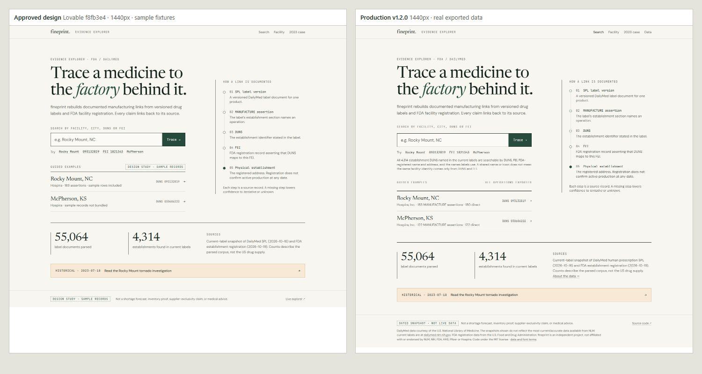

**Facility, 1440 px**
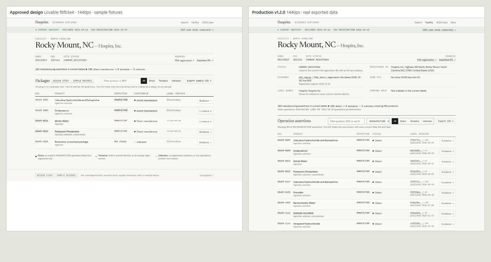

**Evidence drawer, 1440 px**
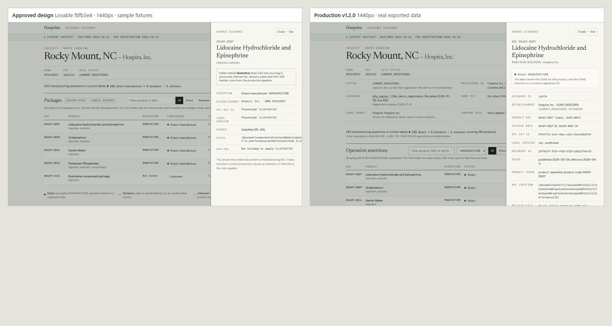

**2023 case, 1440 px**
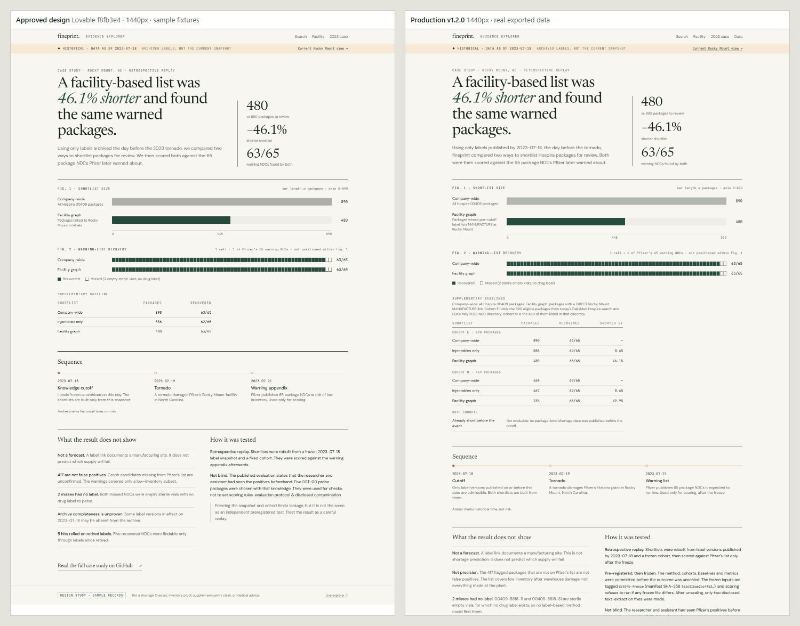

**Phone, 390 px**

| Home | Facility | Drawer | 2023 case |
|---|---|---|---|
| 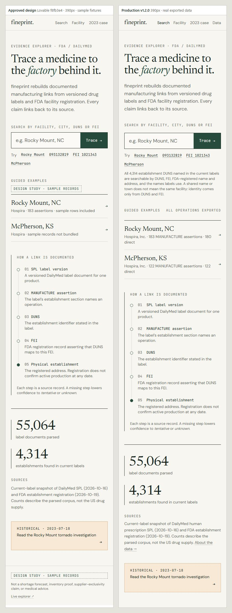 | 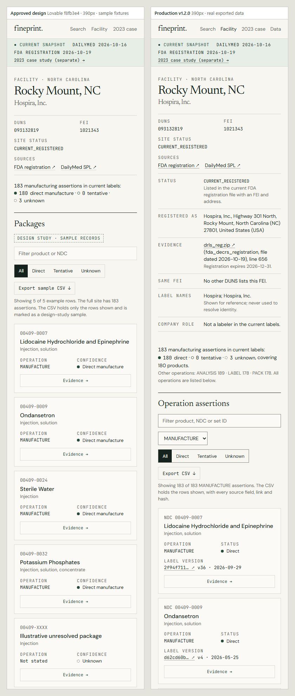 | 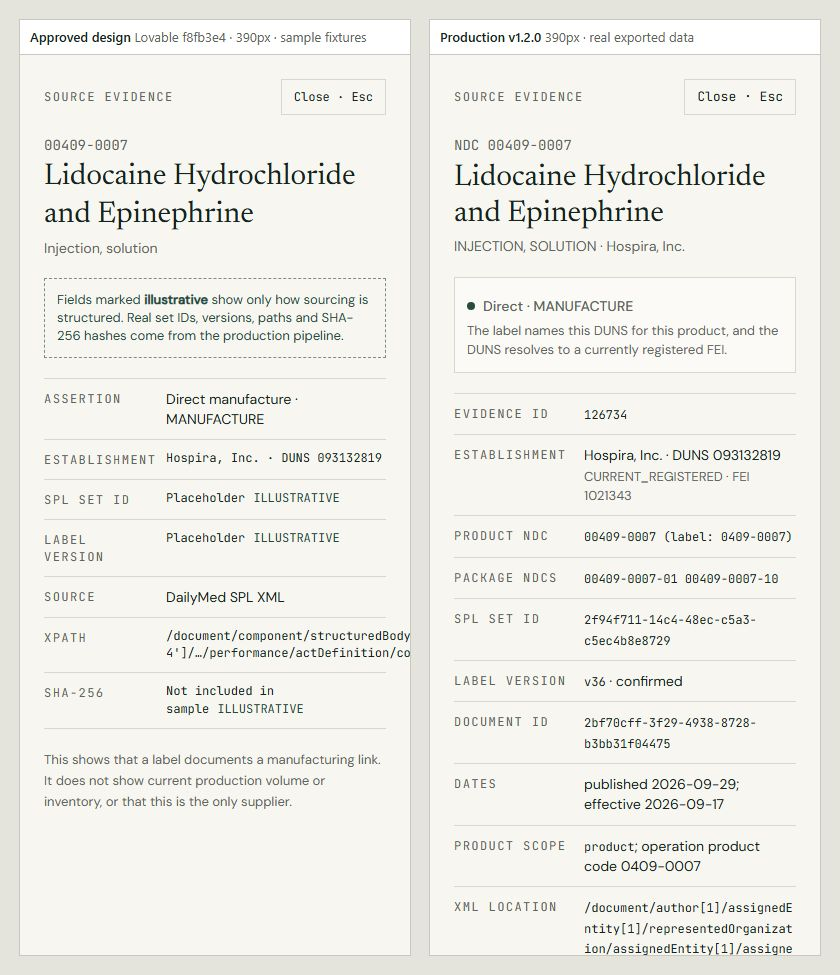 | 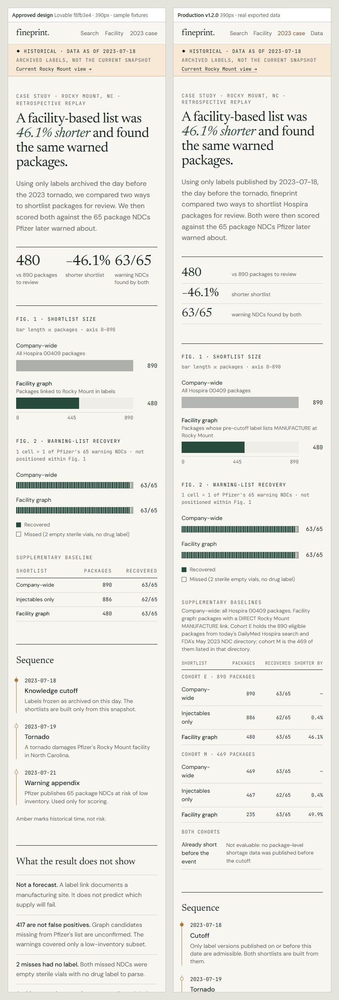 |

**Production at 768, 390 and 320 px**
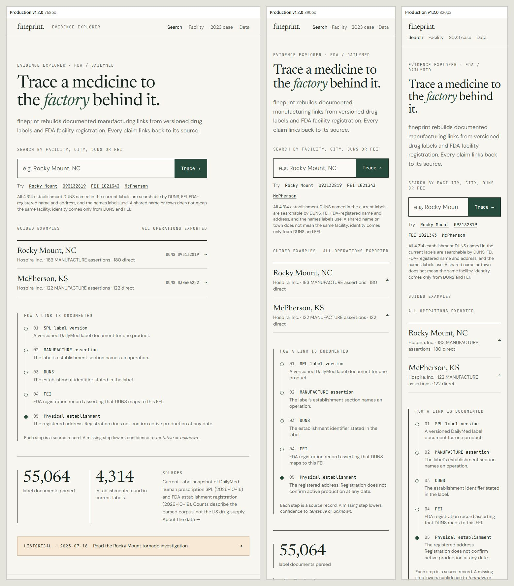
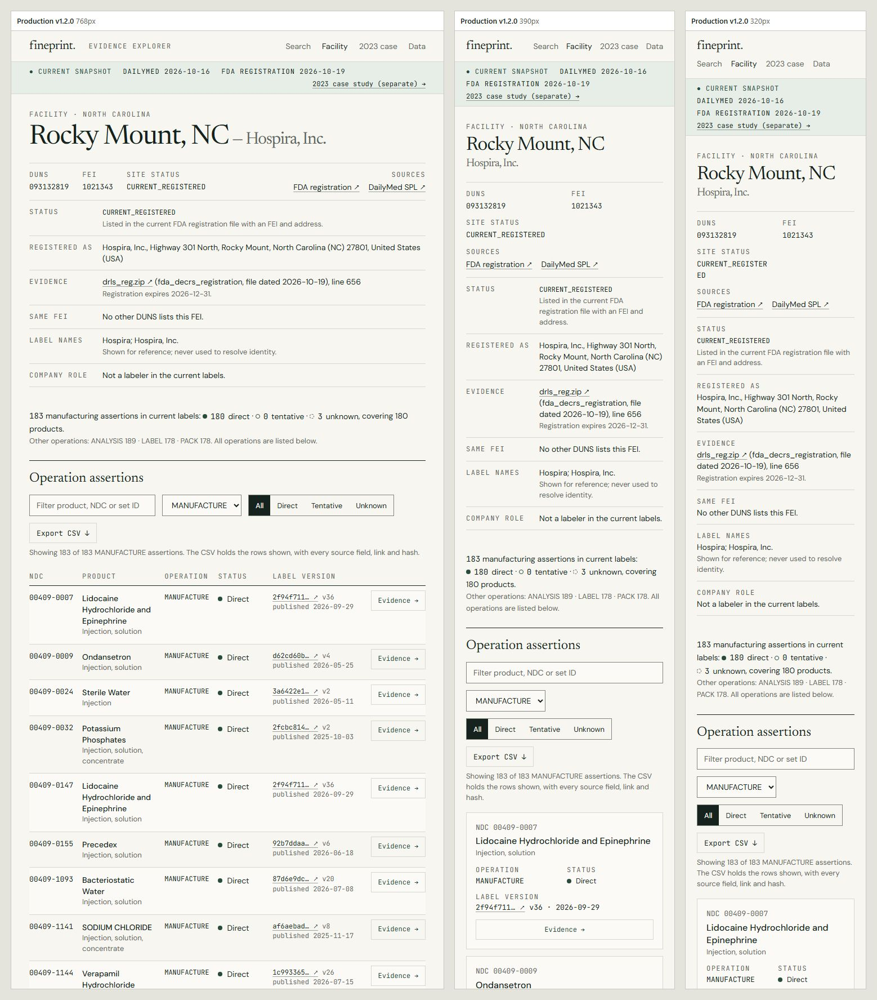
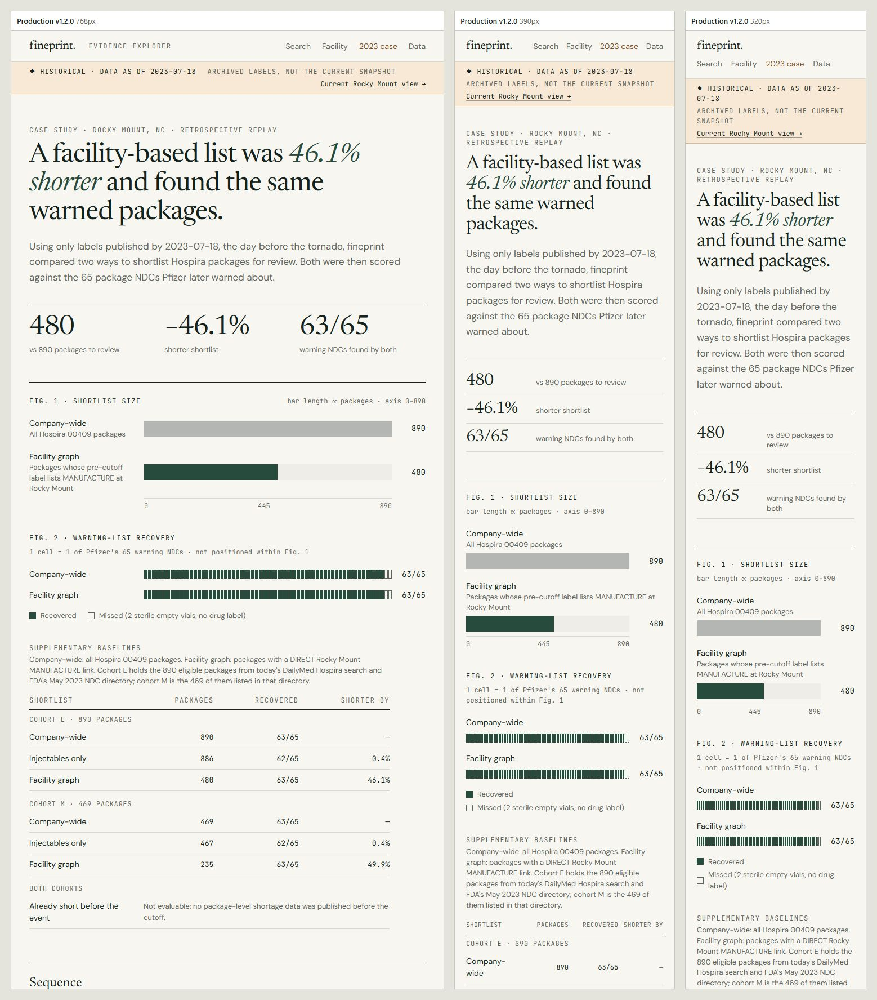

## 4. Public URLs
- **Explorer:** <https://s2002kumar.github.io/fineprint/>
  - Rocky Mount: <https://s2002kumar.github.io/fineprint/#/facility/093132819>
  - McPherson: <https://s2002kumar.github.io/fineprint/#/facility/030606222>
  - 2023 case: <https://s2002kumar.github.io/fineprint/#/rocky-mount-2023>
  - About the data: <https://s2002kumar.github.io/fineprint/#/about>
- **Repository:** <https://github.com/s2002kumar/fineprint>
  - Pull request: <https://github.com/s2002kumar/fineprint/pull/1>
  - Release: <https://github.com/s2002kumar/fineprint/releases/tag/v1.2.0>

## 5. Known issues and remaining limitations
1. **The merge commit `590e97e` carries a personal email.** GitHub authored PR #1's merge commit with the account's
   default commit email (an outlook.com address), not the repository's noreply identity. Every other fineprint commit uses
   the noreply address.
   - The same address already appears in the author's other public repositories.
   - PR #1 keeps the commit reachable even if `main` were rewritten.
   - The owner therefore chose to keep and disclose it rather than force-push `main`.
   - Future merges should be made locally with the noreply identity. Turning on GitHub's "Keep my email addresses
     private" stops web merges from using the personal address.
2. **No physical phone or screen-reader test.** Phone layouts, keyboard behavior and ARIA wiring were checked in
   headless Chrome only.
3. **Dark mode was removed.** The approved design defines a light theme only.
4. **Fonts add weight.** A first visit to the home page transfers about 0.67 MB gzip-compressed, of which about 0.38 MB
   is fonts (1.6 MB uncompressed). Fonts are `font-display: swap`; the two main faces are preloaded.
5. **Design fidelity was checked by side-by-side screenshots, not a pixel diff.** Arrows (→ ↗) and dots (● ◆) are not
   in the fonts' latin subset. They fall back to system glyphs, as they do in the prototype.
6. **Facility headings outside the US use the firm name** (see departure 8).
7. **The CSV download was verified by capturing the Blob each button creates.** Headless Chrome does not save files,
   so the saved-file path was not exercised.
8. **The prototype repository is private.** The comparison images above are its public record.
9. **All v1.1.0 known issues still apply:**
   - internal documents remain in history up to `v1.0.0`;
   - the frozen `seal.tag_commit` value;
   - evidence IDs are database row keys;
   - the explorer is a dated snapshot;
   - non-example pages list MANUFACTURE rows only.

   See [PUBLIC_RELEASE_REVIEW.md](PUBLIC_RELEASE_REVIEW.md) §4.

## 6. Still needs a human
- Look at the explorer on a real phone and with a screen reader (VoiceOver or NVDA), especially the evidence drawer.
- Read the new page copy, which was corrected against `docs/EVALUATION_REPORT.md`, for accuracy and tone.
- Optionally, enable GitHub email privacy (known issue 1).
- Open items from v1.1.0:
  - the independent audit in [docs/HUMAN_AUDIT_WORKSHEET.md](docs/HUMAN_AUDIT_WORKSHEET.md), not yet performed;
  - deletion decisions for local backups and scratch databases.

No forecasting, AI or research features were added. Work stopped after this release.
