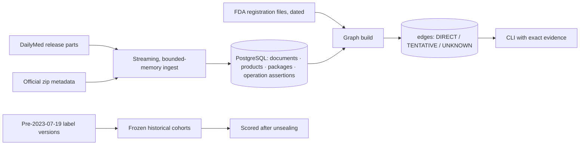

# fineprint

**Which factory actually makes your medicine?**

fineprint ingests the complete current DailyMed human-prescription label release into PostgreSQL as an
operation-aware provenance graph. It answers *which registered facility manufactures this product* and
cites the exact XML element and the dated FDA registration line behind every answer.

Missing or unverifiable evidence is reported as **TENTATIVE** or **UNKNOWN**, never guessed. A labeler is
never treated as a factory, and PACK/LABEL never counts as MANUFACTURE.

It was then tested on a real event. After the July 19, 2023 tornado at Pfizer/Hospira's Rocky Mount plant,
could labels published *before* the tornado have narrowed the list of affected products? The evaluation
was pre-registered and frozen before the outcome was unsealed.

## Results (all measured; see the linked reports)
| National graph (DailyMed release 2026-10-16) | |
|---|---|
| Archive members ingested / failed | **55,064 / 0** (6 parts, 17.98 GB; every MD5 = advertised) |
| Ingest time · peak memory · database | 23.1 min · **73 MB RSS** · 532 MB |
| Crash + kill + resume (real data) | table fingerprints **identical** to a clean run |
| Products in current labels | 80,508: **30.6% DIRECT** site · 0.5% tentative · 1.2% unknown site · 67.6% no manufacture evidence (broken down by reason) |
| Manufacturing DUNS resolved to a registered FDA facility | **76.9%** (2,562 of 3,333); 19.7% not found, 3.3% stale |
| Query latency | 3–32 ms per lookup; `evidence --raw` re-reads the 3 GB source and verifies its hashes in 81 ms |
| Incremental refresh (official 2026-10-19 daily update) | 207 labels in 42 s → 80 edges added, 89 removed (withdrawn per DailyMed's deletion list), 624 carried forward to newer versions; re-applying it: **0 changes** |
| Clean-clone reproduction | every table fingerprint, frozen historical file and evaluation result **identical** |

| Rocky Mount 2023 replay (pre-registered, frozen, then scored) | Candidates | Pfizer warnings recovered |
|---|---|---|
| All Hospira `00409` packages (B1) | 890 | 63 / 65 |
| Injectables only (B2) | 886 | 62 / 65 |
| **fineprint: explicit Rocky Mount MANUFACTURE links** | **480 (−46%)** | **63 / 65** |
| Same, on the independent May 2023 FDA directory cohort | 235 vs 469 (−50%) | 63 / 65 |

The 2 unrecovered warnings are sterile *empty vials*, for which no drug label exists. The "already short"
baseline was **not evaluable**: no admissible pre-event shortage data exists at package level. A sample of
40 classified links was checked against raw XML before unsealing, and all 40 were verified. The auditor
was an AI assistant, not a human. Details: [docs/EVALUATION_REPORT.md](docs/EVALUATION_REPORT.md).

## What an answer looks like (real output)
```text
$ python -I scripts/fp.py product 0409-4346
SCOPE: DailyMed release 2026-10-16 (6 parts) | FDA registration as of 2026-10-19 | graph build 6 — current state only, not historical

00409-4346  Aminocaproic Acid  INJECTION, SOLUTION  [labeler: Hospira, Inc. — a labeler is not a facility]
  set 1c5bc1dd-e9ec-44c1-9281-67ad482315d9 v20  published 2026-05-04  version selection: confirmed
  MANUFACTURE DIRECT:
    093132819  FEI 1021343 — Hospira, Inc., Highway 301 North, Rocky Mount, North Carolina (NC) 27801  [evidence 105515]
    860037912  FEI 3008316085 — Pfizer Healthcare India Private Limited, … Andhra Pradesh, India       [evidence 105517]
  MANUFACTURE TENTATIVE: none
  MANUFACTURE UNKNOWN: none
  other operations (not manufacture): ANALYSIS 093132819 DIRECT [105513]; LABEL …; PACK …

$ python -I scripts/fp.py compare 093132819 030606222 --labeler 141588017
MANUFACTURE at 093132819 vs 030606222 (labeler 141588017): {'only_a': 144, 'only_b': 62, 'both': 27}

$ python -I scripts/fp.py evidence 105515 --raw     # part SHA-256 → member → XML → XPath → raw element → FDA line
```
More examples, including an unresolved manufacturer, are in [evidence/dst03/examples.txt](evidence/dst03/examples.txt).

## How it works

- **Ingest.** Stdlib streaming XML/ZIP with hard byte caps and path-traversal checks. Each document is stored in a savepoint so a bad one is isolated; work commits per batch, so a crash loses at most one batch; resume is idempotent; DUNS operations are deduplicated on `(set_id, version, xml_sha256)`.
- **Graph.**
  - One canonical version per label, chosen from official metadata.
  - DUNS → FEI → address from FDA DECRS. Older dated snapshots mark identities as STALE rather than dropping or guessing them.
  - Product- and package-level NDCs are normalized in separate columns, never conflated.
- **Historical domain** is file-based and physically separate from the national schema. Its inputs are DailyMed versions, FDA SPL-by-document-ID retrieval, 2023 monthly archives read by HTTP Range, and the archived 2023 FDA NDC Directory.

Read more: [docs/ARCHITECTURE.md](docs/ARCHITECTURE.md) (schema, provenance chain, rules).

## Limitations (read before citing numbers)
- **Current answers describe the 2026-10-16 release and FDA registrations as of 2026-10-19.** Labels can be
  stale or incomplete. 23% of products come from labels with no establishment block at all.
- **The DUNS → facility link comes from FDA registration files.** 656 manufacturing DUNS (19.7%) appear in
  no snapshot and stay UNKNOWN.
- **The 2023 frame is not proven complete.** DailyMed's all-labels-on-a-date export was not obtained, and one
  set's cutoff version is unretrievable.
- **Rocky Mount identity for 2023 rests on 2015 and 2022 records.** 2023 registration status is not established.
- **The outcome is a low-inventory warning list, not a list of what Rocky Mount made.** "Flagged but not listed"
  is not a false positive.
- **No shortage prediction, substitutes, inventory, or claims about all manufacturers.**

## Reproduce
```sh
python -I -m unittest discover -s tests -t .                          # 75 tests; 20 need psycopg + PostgreSQL (they skip otherwise)
python -I scripts/dst01_fetch_release.py --out evidence/dst01/release_manifest.json
python -I scripts/dst01_ingest.py --manifest evidence/dst01/release_manifest.json --db fineprint
python -I scripts/dst02_registration.py --db fineprint --out evidence/dst02/registration_manifest.json
python -I scripts/dst02_build_graph.py --db fineprint --verify-rebuild
python -I scripts/fp.py coverage
```
Full guide, offline re-verification, reference fingerprints and the one-command clean-clone check:
[docs/REPRODUCIBILITY.md](docs/REPRODUCIBILITY.md).

## Repository map
| Path | Contents |
|---|---|
| `src/fineprint/` | `spl` (parser), `ingest`, `graph`, `identity`, `cli`, `historical*`, `download`, `safezip`, `ndc` |
| `migrations/` | PostgreSQL schema (additive, checksummed) |
| `scripts/` | Pipeline steps (`dst01_*`, `dst02_*`, `hist_*`), CLI `fp.py`, reproduction tools |
| `evidence/` | Committed run evidence: manifests, coverage, benchmarks, frozen historical cohorts, audit, results |
| `docs/` | Architecture, evaluation report, reproducibility guide, pre-registered plan, progress log, gate history |
| `tests/` | Unit, PostgreSQL integration, crash/resume, CLI, historical rules, privacy guards |

## Data and attribution
DailyMed (NLM) SPL documents and FDA files are U.S. government works. Personal contact fields in FDA
registration data are dropped at parse time. All requests use a generic User-Agent. Prior art includes
ProPublica's Rx Inspector data; fineprint's contribution is reproducible national ingestion,
operation-aware provenance, explicit unresolved identity, and a leakage-controlled historical test.
