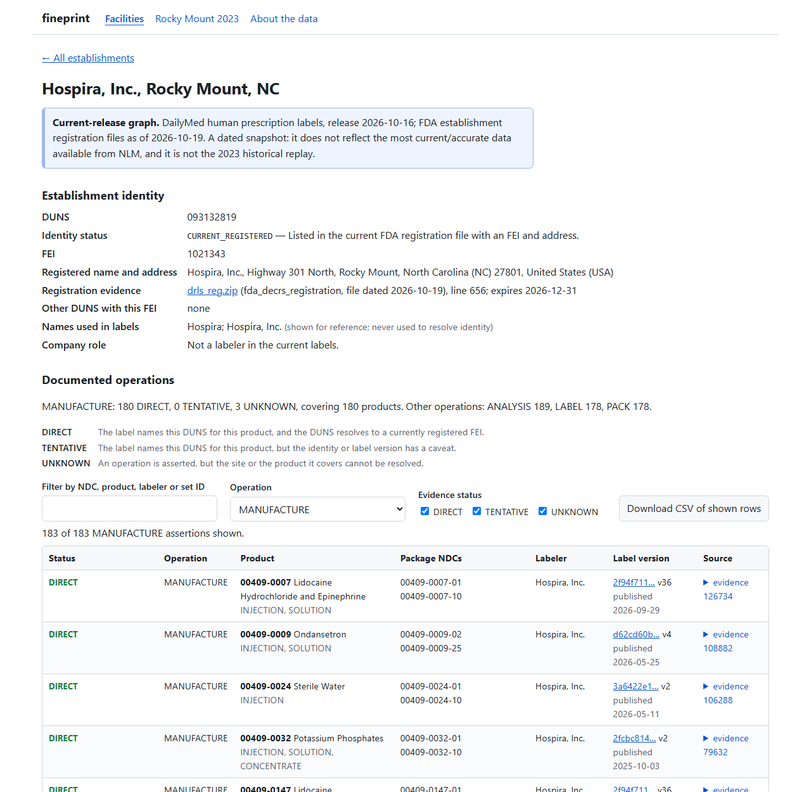
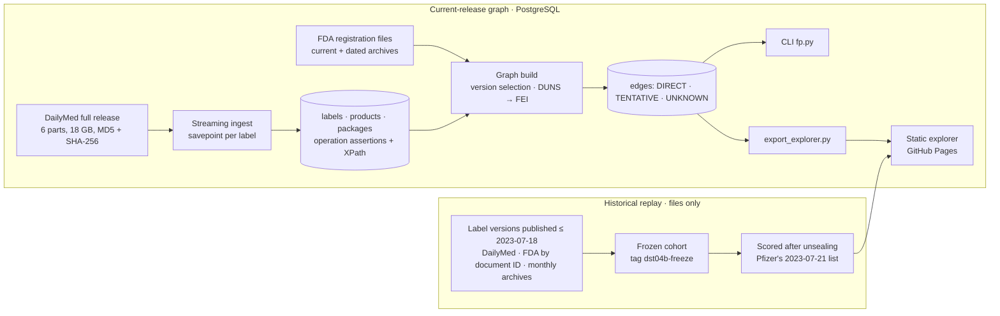

# fineprint

**Which factory actually makes your medicine?**

fineprint turns fragmented FDA manufacturing records into an auditable facility-to-drug graph. In a historical evaluation of Pfizer's 2023 Rocky Mount disruption, it identified the same 63 publicly flagged NDCs as a company-wide search using a 46% shorter investigation list.

Concretely:
- Using only labels published before the tornado, the graph listed **480** Hospira packages with a documented Rocky Mount manufacturing link. **63** of the **65** NDCs on Pfizer's July 21, 2023 warning list were among them.
- The company-wide baseline (every Hospira `00409` package) needed **890** candidates to reach the same 63.

The result measures recall of a known warning list and the size of the list to investigate. It does not measure precision, and it is not shortage prediction.

**[Open the Facility Evidence Explorer](https://s2002kumar.github.io/fineprint/)** · [Case study](docs/CASE_STUDY.md) ·
[Evaluation report](docs/EVALUATION_REPORT.md) · [Example queries](docs/EXAMPLE_QUERIES.md) · [Metrics](docs/METRICS.md)



## Why the records are hard to connect
- **Labels name companies, not factories.** A drug label (SPL) names the *labeler*: the company on the box. Factories
  appear only in an optional establishment section. There, each one is a DUNS number with operation codes
  (manufacture, pack, label, test) and the product codes they cover.
- **Identity lives elsewhere.** Turning a DUNS into a physical site takes FDA's establishment registration file
  (DECRS). FDA regenerates that file daily and does not keep old versions, and many DUNS in labels never appear in it.
- **Labels change.** A label is a versioned set. Old versions are retired, so reconstructing what was on record on a
  past date takes archive work.
- **NDC formats collide.** Product codes (5-4) and package codes (5-4-2) are easy to conflate.

In the current release, **67.6%** of 80,508 products have no product-level MANUFACTURE statement in their label.
**19.7%** of the 3,333 DUNS named as manufacturers match no record in any loaded FDA registration file.

## How the evidence graph works

- **One edge per assertion.** An edge is a single `<performance>` element in a single label version: product code →
  operation code → DUNS → FEI and address in a dated FDA file.
- **Every edge cites its source:** set ID, version, document ID, XML location, XML SHA-256 and release part.
  `fp.py evidence <id> --raw` re-opens the archive, re-checks both hashes and prints the element.
- **Status:**
  - **DIRECT**: a product-scoped link to a currently registered FEI.
  - **TENTATIVE**: stale or partial identity, or an ambiguous label version.
  - **UNKNOWN**: no registration evidence, or the label does not say which product the operation covers.
  - The reason is stored with each edge.
- **Nothing is inferred.** No site comes from a company name, an address string or a product name. A labeler is never
  treated as a factory, and PACK or LABEL never counts as MANUFACTURE.
- **The two datasets never mix.** The historical replay is file-based, with no database import and no 2026 data, and
  its frozen inputs are pinned by a git tag.

Details: [docs/ARCHITECTURE.md](docs/ARCHITECTURE.md).

## Rocky Mount, July 2023
A tornado hit Pfizer's Hospira plant in Rocky Mount, NC (DUNS `093132819`) on 2023-07-19, and Pfizer published a
low-inventory warning list two days later. The method was pre-registered and the cohort frozen before that list was
retrieved.

| Method (labels published ≤ 2023-07-18) | Candidates | Flagged NDCs recovered | List size vs company-wide |
|---|---|---|---|
| Company-wide: every Hospira `00409` package | 890 | 63 / 65 | — |
| Injectables only | 886 | 62 / 65 | −0.4% |
| **fineprint: DIRECT Rocky Mount MANUFACTURE link** | **480** | **63 / 65** | **−46.1%** |
| Same comparison on FDA's May 2023 NDC directory cohort | 235 vs 469 | 63 / 65 each | −49.9% |
| "Already short before the event" | not evaluable: no package-level pre-event data | | |

- **The 2 misses are sterile empty vials,** which have no drug label at all.
- **The 417 flagged packages that are not on the list are not false positives.** The list reflects low inventory
  after warehouse damage, not a census of what the plant made.
- **No human has audited the links yet.** A pre-unsealing check of 40 links was done by the AI assistant that built
  the project. A [worksheet for an independent human audit](docs/HUMAN_AUDIT_WORKSHEET.md) is provided.

Full write-up: [docs/CASE_STUDY.md](docs/CASE_STUDY.md).

## Explore or run it
- **Browse:** the [explorer](https://s2002kumar.github.io/fineprint/) is a static export with no server.
  - Rocky Mount and McPherson are worked examples with every operation.
  - All 4,314 establishment DUNS in the current labels can be searched, each with its MANUFACTURE assertions.
  - Every table downloads as CSV. Its data files and checksums are in `site/data/manifest.json`.
- **Query locally** after building the database ([docs/REPRODUCIBILITY.md](docs/REPRODUCIBILITY.md)):
  ```sh
  python -I scripts/fp.py product 0409-4346          # which registered sites manufacture this product
  python -I scripts/fp.py facility 030606222         # what a site is documented to make
  python -I scripts/fp.py evidence 105515 --raw      # re-read the cited XML element from the archive
  ```
  [Five worked examples with real output](docs/EXAMPLE_QUERIES.md).
- **Test:** `python -I -m unittest discover -s tests -t .` runs 84 tests. 20 of them need PostgreSQL and skip without it;
  CI runs all of them against PostgreSQL 18.

## Scale (measured, reference machine)
| | |
|---|---|
| Ingest | 55,064 label files from 18 GB in 23.1 min, 0 failed, peak memory 73 MB |
| Crash, kill and resume on real data | table fingerprints identical to a clean run |
| Graph rebuild | 9.6–12.5 s, byte-identical fingerprints on rebuild and on a clean-clone reproduction |
| Lookups | 3–32 ms median; `evidence --raw` re-reads and re-hashes the source in 81 ms |
| Daily update (2026-10-19) | 207 labels ingested in 4.2 s; +80 / −89 edges; re-applying it changes nothing |

Sources and the full list: [docs/METRICS.md](docs/METRICS.md).

## Limitations
- **Archival incompleteness.** The 2023 label universe is not proven complete: DailyMed's all-labels-on-a-date export
  was not obtained, and one label's pre-cutoff version could not be retrieved. Five recovered NDCs exist only in
  retired labels found through FDA and archive retrieval.
- **Coverage gaps.** Many labels state no manufacturing site, and unregistered DUNS stay UNKNOWN. The graph can show
  what the records assert, not everything a plant makes.
- **Exposure is not shortage.** A documented link says a site is on record for a product. It says nothing about
  volume, inventory, other sites or whether the product will run short.
- **Dated snapshots.** The current graph reflects the DailyMed release of 2026-10-16 and FDA registration files of
  2026-10-19. Rocky Mount's 2023 identity rests on 2015 and 2022 records.

## Repository map
| Path | Contents |
|---|---|
| `src/fineprint/` | SPL parser, ingest, graph rules, identity, CLI, historical replay, safe ZIP and download code |
| `migrations/` | PostgreSQL schema (additive) |
| `scripts/` | Pipeline steps, CLI `fp.py`, explorer export and verification, reproduction and audit tools |
| `site/` | Static explorer and its data exports (`site/data/manifest.json` lists every file with SHA-256) |
| `evidence/` | Committed run evidence: manifests, coverage, benchmarks, frozen historical cohorts, results |
| `docs/` | Case study, architecture, evaluation report, pre-registered plan, metrics, audit worksheet |
| `tests/` | Unit, PostgreSQL integration, crash/resume, historical rules, site data and privacy guards |

## License, data and attribution
- **Code:** [MIT](LICENSE). The data keeps its own terms; see [NOTICE.md](NOTICE.md).
- **DailyMed data:** courtesy of the U.S. National Library of Medicine. The snapshots used here do not reflect the
  most current/accurate data available from NLM.
- **FDA data:** registration and NDC data are from the U.S. Food and Drug Administration.
- **Not redistributed:** personal contact fields in FDA files (dropped at parse time), raw archives and label text.
- **Independence:** fineprint is an independent project. It is not affiliated with or endorsed by NLM, NIH, FDA,
  HHS, Pfizer or Hospira, and it is not medical advice.
