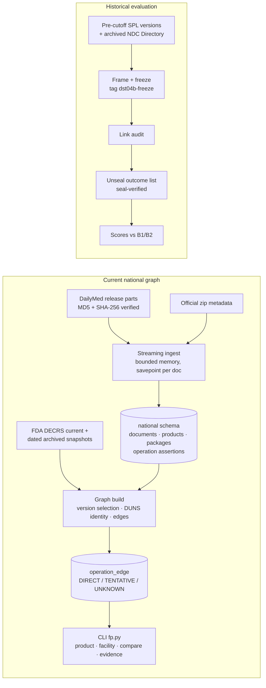

# Architecture

fineprint has two deliberately separate evidence domains.

| | Current national graph | Historical 2023 evaluation |
|---|---|---|
| Inputs | DailyMed human-Rx full release (6 parts, 18 GB), official zip metadata, FDA DECRS registration files | Pre-cutoff SPL versions (DailyMed `getFile`, FDA SPL by document ID, 2023 monthly archives), archived FDA NDC Directory and DECRS captures |
| Storage | PostgreSQL schema `national` | Hash-verified file cache + `evidence/historical/*.json` |
| Guard | `source_file.source_role` CHECK = `'current'` | No database driver imported (asserted); source-domain allow-list; cutoff checks |
| Answers | "What do current records assert?" | "What did records published by 2023-07-18 assert?" |

## Schema (`migrations/001`, `002`; additive, immutable, checksummed)
| Table | Key / role |
|---|---|
| `source_file` | One row per downloaded file. SHA-256, MD5 versus advertised, ETag, retrieval and publisher timestamps, path relative to `$FINEPRINT_DATA` |
| `archive_member` | One row per ZIP member: `loaded` / `duplicate` / `failed`; the unit of resume and failure isolation |
| `dead_letter` | Failed members with stage and error |
| `spl_document` | Unique on `(set_id, version, xml_sha256)`. `published_date` comes **only** from official metadata; the filename date and XML `effectiveTime` are stored separately |
| `organization_mention` | Every organization as positioned in the SPL author tree: `labeler` (a company, never a site), `registrant`, `establishment` |
| `product`, `package` | Raw NDCs plus normalized `ndc_product_5_4` / `ndc_package_5_4_2` in separate tables (never conflated) |
| `operation_assertion` | One per (performance element, product code, DUNS): raw NCI operation code, verbatim name, product scope, XPath `loc` |
| `operation_type` | Code → canonical name, derived from observed spellings |
| `registration_record` | FDA DECRS rows. Contact names, emails and agent details are dropped at parse time |
| `set_version_selection` | One canonical version per set, with class `confirmed` / `unconfirmed` / `ambiguous` / `unresolved` |
| `duns_identity` | `CURRENT_REGISTERED` › `CURRENT_REGISTERED_NO_FEI` › `CURRENT_EXCLUDED` › `STALE_REGISTERED` › `NOT_FOUND`, with FEI history and sharing |
| `facility` | One per FEI with its DUNS, firm names and addresses |
| `operation_edge` | product → operation → DUNS → FEI, keyed by `assertion_pk` (evidence IDs are stable across rebuilds) |

## Provenance chain (what `fp.py evidence <id> --raw` walks)
1. `operation_edge.assertion_pk` leads to the `operation_assertion` row (code, product code, DUNS, XPath).
2. That row belongs to an `spl_document` (set, version, XML SHA-256, published date), stored in an `archive_member` (member SHA-256), inside a `source_file` (part SHA-256, retrieval time).
3. The CLI re-opens the part, re-hashes the member and the XML, and prints the cited XML element verbatim.
4. On the identity side, `duns_identity` points to a `registration_record` line, which points to its own `source_file` (FDA file SHA-256 and generation date; archive capture time for stale snapshots).

## Rules
- **Version selection.** Use the official metadata version when present in the release, otherwise the highest version. Same-version byte conflicts are `unresolved`, with no document chosen.
- **Edge confidence.** One pure function, `graph.edge_confidence`, which a test proves equal to the SQL.
  - **DIRECT**: product-scoped, current registration with FEI, not expired, FEI unchanged across snapshots, version selection not ambiguous.
  - **TENTATIVE**: partial or stale identity, or an ambiguous version.
  - **UNKNOWN**: no registration evidence, no DUNS, or no product scope.
- **Never inferred.** No facility comes from a labeler, company name, address string or product name. PACK and LABEL are never MANUFACTURE.

## Incremental refresh (DST-06, manual; no scheduler)
`scripts/dst06_refresh.py --db <db> --update <dm_spl_daily|weekly_update_*.zip>` handles one official update archive:
1. It downloads the archive (MD5 must match the advertised value) and ingests only its `prescription/` members, through the same idempotent path as the full release.
2. It loads the update's `files_deleted.txt` into `release_retraction`.
3. It rebuilds the graph over **active** documents, meaning members no later update retracted. A newer version from an update is selected as `UPDATE_NEWER_VERSION`.
4. It records `refresh_run` / `refresh_change`, classifying each edge (keyed by set, product code, DUNS and operation) as added, removed, modified or carried forward.

Re-applying the same archive changes nothing. With no updates loaded, graph fingerprints equal the release build (migration `003` is additive). Two limits remain: updates must be applied in chronological order, and documents added by updates have no `published_date`, because the official metadata file is only refreshed with full releases.

## Reliability mechanisms
- Downloads resume with Range + If-Range on the ETag, so a changed object restarts rather than splicing. MD5 must match the advertised value before a file is accepted.
- Ingest processes one member at a time under hard byte caps; peak RSS was 73 MB for 18 GB.
- Documents are stored in per-document savepoints and committed per batch, behind an advisory-lock single writer.
- `MemoryError` rolls the batch back and retries it; it is never dead-lettered.
- Re-runs skip recorded members. Crash/kill/resume equality is tested on real data.
- The graph rebuilds atomically in one transaction; natural-key fingerprints prove rebuilds and reproductions identical.
