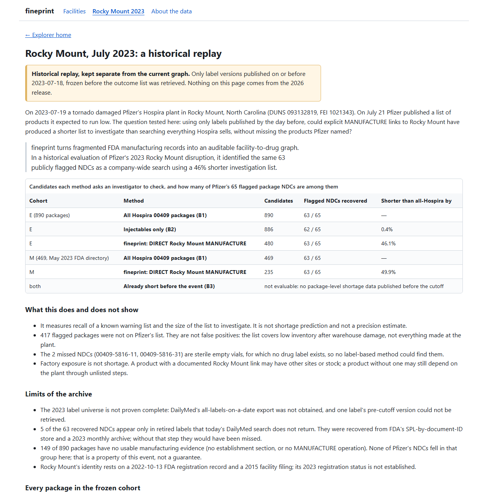

# Case study: which products depend on one plant?

## 1. Problem
When a drug plant stops, hospitals, distributors and regulators all ask which products it makes. Public records
contain part of the answer, scattered across systems that were not designed to be joined:

- **Drug labels (SPL, published through DailyMed).** A label names a *labeler*, the company that markets the
  product. Factories appear only in an optional establishment section. Each is given as a DUNS number with operation
  codes (manufacture, API manufacture, pack, label, analysis) and the product codes each operation covers.
- **FDA establishment registration (DECRS).** This file maps a DUNS to an FDA Establishment Identifier (FEI) and a
  street address. FDA regenerates it daily and does not publish old versions.
- **Label versions.** Labels are revised. Older versions are retired from search, so the record as it stood on a
  given date has to be reconstructed.

fineprint's question is narrow: **what do these public records actually establish about facility-to-product links,
and what do they leave unresolved?** It does not estimate supply, inventory or shortage risk.

## 2. Evidence
| Source | Used for | Snapshot |
|---|---|---|
| DailyMed human prescription full release | current labels | 2026-10-16; 6 parts, 17,979,089,637 bytes; every MD5 = advertised |
| DailyMed official ZIP metadata | each label's current version and publication date | 2026-10-16 |
| FDA DECRS registration files | DUNS → FEI → address | current 2026-10-19, plus archived files from 2024-12-23, 2025-12-05 and 2026-08-21 |
| DailyMed label versions, FDA SPL by document ID, 2023 monthly archives | the label record as of 2023-07-18 | per version, each hash-verified |
| FDA NDC Directory | an independent 2023 Hospira product list | generated 2023-05-05 |
| Pfizer's July 21, 2023 warning appendix (hosted by FDA) | outcome only, sealed until the cohort was frozen | retrieved 2026-10-20 |

What the current release shows:
- 52,747 label sets yield 80,508 products.
- **30.6%** of products have a DIRECT manufacturing link, 0.5% a TENTATIVE one and 1.2% an UNKNOWN site.
- **67.6%** have no product-level MANUFACTURE assertion at all. Of those, 18,453 come from labels with no
  establishment section, and 28,123 list only other operations for the product (such as packing, labeling, testing
  or API manufacture).
- Of 3,333 DUNS named as manufacturers, **76.9%** resolve to a registered facility, 3.3% only to an older file and
  **19.7%** to nothing.

## 3. Engineering decisions
- **Keep every assertion, with its exact location.** Each `<performance>` element becomes one row carrying:
  - its raw operation code, product code and DUNS;
  - its XPath in the label;
  - the label's set ID, version, document ID and SHA-256;
  - the release part and archive member it came from.

  The CLI can re-open the 3 GB part, re-hash the member and the XML, and print the cited element.
- **Make uncertainty a first-class value.** Each edge is DIRECT, TENTATIVE or UNKNOWN, and records why. One pure
  function holds the rule, and a test proves the SQL build agrees with it.
- **Never infer a site.** No identity comes from a company name, an address string or a product name. A labeler is
  not a factory, PACK and LABEL are not MANUFACTURE, and product NDCs (5-4) and package NDCs (5-4-2) are stored in
  separate columns.
- **Use dated identity, not today's.** DUNS → FEI comes from FDA registration files with their generation dates.
  Where FDA no longer serves an older file, it comes from Internet Archive captures. A DUNS listed only in an older
  file is marked STALE rather than dropped or guessed.
- **Make the ingest restartable and bounded.**
  - It streams the archives with hard byte caps and path checks, under a single-writer lock.
  - Each label is stored in its own savepoint, so one bad document is isolated; work commits per batch.
  - Re-runs are idempotent.
  - The 18 GB release was ingested at a peak of 73 MB. A real crash, kill, out-of-memory and resume sequence
    produced table fingerprints identical to a clean run.
- **Keep the two datasets apart.** The current graph lives in PostgreSQL. The 2023 replay is file-based: its scripts
  never import the database driver, and the code asserts this. Its inputs are frozen and pinned by a git tag.
- **Publish statically.** The explorer is a deterministic export of the graph, served as plain files with a
  checksummed manifest. Its CSV downloads come from the same JavaScript in the browser and in a verifier that
  compares every row with the database.

## 4. Experiment: Rocky Mount, July 2023
**Event.** A tornado damaged Pfizer's Hospira plant in Rocky Mount, NC (DUNS `093132819`, FEI `1021343`) on
2023-07-19. On July 21 Pfizer published 65 package NDCs it expected to run low.

**Question.** Using only labels published by 2023-07-18, can explicit MANUFACTURE links to Rocky Mount produce a
shorter list to investigate than "everything Hospira sells", without missing the flagged products?

**Protocol.** Each step was committed before the next ([pre-registered plan](historical_panel_plan.md)).
1. The method was registered before any frame was built, and the outcome stayed sealed.
2. The cohort definitions, classification precedence, baselines and metrics (amendment A5) were committed before
   the freeze was computed.
3. The frozen inputs were tagged `dst04b-freeze`. Scoring refuses to run unless every frozen file equals its tagged
   copy.
4. A 40-link audit was committed before unsealing.
5. After unsealing, only two disclosed PDF text-extraction fixes were made (A5.1, A5.2). No cohort, classification,
   baseline or metric changed.

**Cohorts.**
- **E** (890 packages) comes from 247 label sets. It is the union of today's DailyMed Hospira search and FDA's
  May 2023 NDC directory, with each set's pre-cutoff version.
- **M** (469) is the May 2023 directory subset.

**Recovering retired labels.** 235 cutoff documents were recovered: 189 through DailyMed's version download, 37 from
FDA's SPL-by-document-ID store, and 9 by reading single members out of multi-GB 2023 monthly archives with HTTP Range
requests.

## 5. Findings
| Cohort | Method | Candidates | Flagged NDCs recovered | Shorter than all-Hospira |
|---|---|---|---|---|
| E | All Hospira `00409` packages | 890 | 63 / 65 | — |
| E | Injectables only | 886 | 62 / 65 | 0.4% |
| E | **DIRECT Rocky Mount MANUFACTURE** | **480** | **63 / 65** | **46.1%** |
| M | All Hospira `00409` packages | 469 | 63 / 65 | — |
| M | **DIRECT Rocky Mount MANUFACTURE** | **235** | **63 / 65** | **49.9%** |
| both | Already short before the event | not evaluable | | |

- **Every flagged NDC inside the cohort has a DIRECT Rocky Mount link** (63/63). The two outside it, `00409-5816-11`
  and `-31`, are sterile empty vials, which have no drug label.
- **The injectables-only baseline cannot reach the same recall at any size.** It excludes an oral and inhaled
  acetylcysteine package that was on the list.
- **Archive work mattered.** 5 of the 63 recovered NDCs appear only in retired labels that today's DailyMed search does
  not return: 4 recovered by document ID and 1 from a monthly archive.
- **What the result is:** recall of a known warning list, plus the size of the list to investigate.
- **What it is not:**
  - **Not precision.** The 417 flagged packages that are not on the list are not false positives. The list reflects low
    inventory after warehouse damage, not a census of production.
  - **Not shortage prediction.**
- **Exploratory, not pre-registered.** Packages whose label lists Rocky Mount as the only manufacturer were on the
  list at 57/306; packages with additional sites were at 6/174. This is a hypothesis for a future test only.

## 6. Limitations
- **Archive completeness is unproven.** DailyMed's all-labels-on-a-date export was not obtained, and one set's cutoff
  version could not be retrieved. That set has none of the flagged NDCs.
- **Labels under-report sites.** In the cohort, 149 of 890 packages have no usable manufacturing evidence. None of the
  flagged NDCs fell there, which is a property of this event, not a guarantee.
- **The identity evidence predates 2023.** Rocky Mount's identity rests on a 2015 facility filing and a 2022-10-13
  registration record. Its registration status during 2023 is not established.
- **Exposure is not shortage.** A link to a site does not measure volume, inventory, alternative sources or
  substitution.
- **There has been no independent human audit yet.** The 40/40 pre-unsealing audit was performed by the AI assistant
  that built the project. [HUMAN_AUDIT_WORKSHEET.md](HUMAN_AUDIT_WORKSHEET.md) is a seeded sample for a person to
  check against DailyMed and FDA.
- **One event.** Generalizing needs more events, pre-registered the same way.

Numbers: [EVALUATION_REPORT.md](EVALUATION_REPORT.md), `evidence/historical/evaluation_results.json`,
[METRICS.md](METRICS.md).
